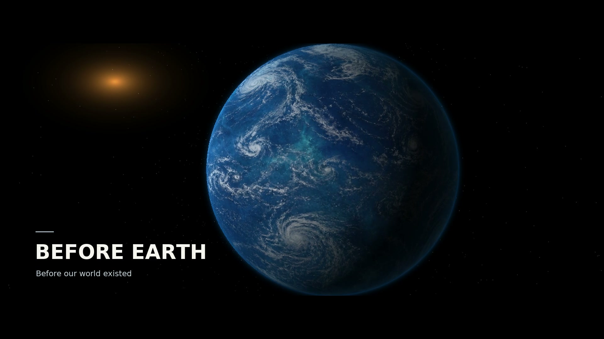

# bookshelf

## The Search for Truth — 40-second cinematic teaser V2

**40 seconds · 1080p · 24fps · Hinglish narration · Story text + procedural VFX**

[**Download the teaser MP4**](https://github.com/Mr-argha-das/bookshelf/raw/refs/heads/arena/efc200ae-bookshelf/film/the-search-for-truth-teaser-40s.mp4?download=1)

A cinematic documentary teaser exploring our origins and humanity's questions about existence. V2 adds ten on-screen story beats, a rotating shaded planet, animated accretion flow, stronger atmospheric effects and sound-synced text reveals. The requested teaser, source renderer, selected image/audio inputs and technical checks are included in this branch.

- [Watch/download file](film/the-search-for-truth-teaser-40s.mp4)
- [Production notes and render instructions](film/TEASER.md)
- [Edit timeline](film/teaser40-edit.json)

Visuals are AI-generated photographic reconstructions with motion/VFX compositing, not live-action or fully animated character footage. No footage or music from a feature film is used.
